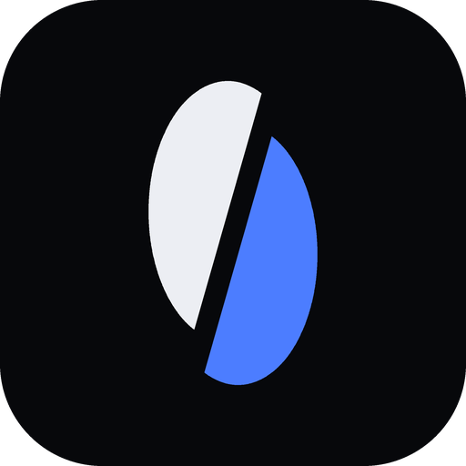

# Rift Design System

This is the single reference for how Rift looks, moves and behaves: the desktop app (Qt Quick/QML), the browser extension and the website.

The design is defined in four places that must stay in sync:

| What | File | Used by |
|---|---|---|
| Tokens (source of truth) | [design/tokens.json](design/tokens.json) | everything |
| QML singleton | [design/Theme.qml](design/Theme.qml) | the app |
| Component library (CSS) | [design/app/app.css](design/app/app.css) + [app.js](design/app/app.js) | the interactive prototype, the extension |
| Brand files | [design/brand/](design/brand) | icons, installers, stores |

Open the prototype by serving the repo root (`python -m http.server 5173`) and visiting `/design/app/`. Every screen is interactive and can be switched between light and dark, compact and comfortable, and any accent from the top bar.

| Page | Covers |
|---|---|
| [index.html](design/app/index.html) | System: principles, color, type, spacing, radius, elevation, motion, icons, every component and state |
| [main.html](design/app/main.html) | Main window, the context and view menus, status bar, window states (empty, kill switch, low disk, clipboard, update) |
| [dialogs.html](design/app/dialogs.html) | Add torrent, Add link, Many links, Duplicate, Remove + undo, Move, Command palette, Refresh link, Create torrent, Limits, Shutdown, Update, Shortcuts, About |
| [settings.html](design/app/settings.html) | Settings window, all 15 pages |
| [tabs.html](design/app/tabs.html) | Search and plugins, RSS and rules, Statistics, Diagnostics and log |
| [more.html](design/app/more.html) | First-run wizard, Import, Player, Mini mode, Quick add, Tray, OS notifications, taskbar, drop overlay, browser extension |
| [logo.html](design/app/logo.html) | The mark, app icon, sizes and wordmark |

---

## 1. Principles

1. **Honest numbers.** Every speed shown is measured payload. The rows add up to the status-bar total, idle shows `0` within 2 s, and a limit is always shown as context ("4.9 of 5 MB/s"). Never animate a number to look faster.
2. **Quiet chrome, loud data.** Surfaces are near-neutral and warm; color is reserved for state (downloading, seeding, error) and the single accent.
3. **One accent.** Cobalt blue by default. The other hues are semantic, never decorative. No neon, no glow, no rainbow gradients.
4. **Everything explains itself.** Every control has a tooltip; disabled items stay visible with a reason; errors say what happened and what to do.
5. **Motion is feedback, not decoration.** Short, springy, meaningful, and fully disabled by reduced-motion.
6. **Roomy, not sparse.** 46 px list rows, 36 px sidebar items, 14 px text. Density is a user choice (compact / comfortable), never a cramped default.

---

## 2. Color

Two themes: **Stone** (light, warm paper and ink) and **Obsidian** (dark, cool ink-black with soft white text). "System" follows the OS.

### Surfaces and text

| Token | Stone | Obsidian | Use |
|---|---|---|---|
| `window` | `#EEEBE4` | `#050608` | window background, toolbar |
| `sidebar` | `#E6E2D8` | `#08090C` | sidebar, title bar, status bar |
| `surface` | `#F6F4EE` | `#0B0C10` | list, details panel, settings body |
| `raised` | `#FCFBF8` | `#12141A` | cards, menus, dialogs, buttons |
| `sunken` | `#DEDAD0` | `#020304` | segmented control track, wells |
| `input` | `#FFFFFF` | `#090A0E` | text fields |
| `text` | `#17140F` | `#ECEEF3` | primary text |
| `text2` | `#575045` | `#A2A7B3` | secondary text |
| `text3` | `#857D70` | `#6A707C` | captions, placeholders, idle icons |
| `line` | ink 12 % | cool white 8.5 % | borders, dividers |
| `lineSoft` | ink 6.5 % | cool white 4.5 % | row separators |
| `hover` / `pressed` | ink 5 / 9 % | cool white 4.5 / 8.5 % | interaction fills |
| `overlay` | ink 38 % | black 66 % | dialog scrim |

Obsidian's lines and hovers are tinted a faint cool blue-white (`rgba(225,232,255,…)`), not pure white. This keeps the dark theme deep and clean instead of grey.

### Accent

| Accent | Stone | Obsidian | On-accent text |
|---|---|---|---|
| **Cobalt** (default) | `#1E46D8` | `#4C7DFF` | white |
| Champagne | `#8E6119` | `#D6B072` | white / `#0B0C10` |
| Jade | `#1C7A58` | `#4CC89A` | white / `#0B0C10` |
| Teal | `#1F7F86` | `#5EC4C4` | white / `#0B0C10` |
| Orchid | `#7F4BB3` | `#C38BEA` | white / `#0B0C10` |
| Ember | `#B4532A` | `#EE8A5E` | white / `#0B0C10` |

Each accent has a hand-tuned value per theme. Derived values: hover (dark: lighter 12 %, light: darker 14 %), pressed, `accentSoft` (14 % / 12 % alpha), and `selection` (16 % / 15 % alpha). Text on the accent is white, unless the accent is light (relative luminance above 0.45 in the prototype, 0.6 in QML); then it's `#0B0C10`. Cobalt always gets white.

### Semantic

| Token | Stone | Obsidian | Meaning |
|---|---|---|---|
| `success` / `down` | `#1C7A58` | `#4CC89A` | seeding, completed, download speed |
| `info` / `up` / `kindHttp` | `#1F7F86` | `#5EC4C4` | upload speed, direct links, scheduled (teal, so it never competes with the blue accent) |
| `signal` | `#7F4BB3` | `#C38BEA` | streaming, pieces in flight |
| `warning` | `#B85F1A` | `#F0924A` | stalled, low disk, alt speed |
| `danger` | `#B32638` | `#F0596A` | errors, kill switch, destructive |
| `violet` | `#55607F` | `#9AA3C7` | checking, moving, fetching metadata |

Each has a `-soft` variant (≈ 12–14 % alpha) for badge and banner backgrounds.

### State → color

| State | Color | Badge extras |
|---|---|---|
| Downloading | accent | pulsing dot, live sheen on progress |
| Seeding, Completed | success | |
| Streaming | signal | pulsing dot |
| Stalled | warning | tooltip explains why |
| Checking, Moving, Fetching metadata | violet | pulsing dot; indeterminate bar for metadata |
| Error, Paused by kill switch | danger | icon + message in the details banner |
| Scheduled | info | tooltip shows start time |
| Paused, Queued | text3 | row dims to 55 % |

### Palettes

- **Connections** (one color per HTTP connection in the segment bar): `#4C7DFF #5EC4C4 #4CC89A #C38BEA #F0924A #D6B072 #E98AA8 #B9C07A`
- **Tags**: `#2F5BE0 #1F7F86 #1C7A58 #7F4BB3 #2A8A8F #B34A6E #B85F1A #575045`

---

## 3. Typography

| Family | Use |
|---|---|
| **Bricolage Grotesque** (variable: opsz 12–96, wdth 75–100, wght 200–800) | all UI text; display sizes use `wdth 78–85` |
| **JetBrains Mono** | numbers (tabular, slashed zero), hashes, paths, captions, shortcuts |
| **Instrument Serif** *italic* | rare emphasis only: empty states, About, wizard, website headlines |

| Role | Size / line | Weight | Notes |
|---|---|---|---|
| caption | 12 / 16 mono | 600 | uppercase, +0.07 em |
| small | 13 / 18 | 450 | help text |
| **body** | **14 / 20** | 450 (550 nav, 600 names) | default |
| num | 13 mono | 400–600 | all speeds, sizes, ETAs |
| title | 16 / 22 | 700 | dialog titles |
| section | 22 / 26 | 700 | settings page titles |
| page | 28 / 30 | 700 | `wdth 85` |
| display / hero | 44 / 56 | 700–800 | stats, empty states |

Numbers always use the mono face with `tnum` so columns don't jitter while values update.

---

## 4. Spacing, size, radius, elevation

- **Spacing scale:** `0 2 4 6 8 12 16 20 24 32 40 48`.
- **Sizes:**

  | | Compact | Comfortable |
  |---|---|---|
  | List row | 46 | 54 |
  | Sidebar item | 36 | 40 |
  | Control | 32 | 36 |
  | Small control | 26 | 30 |
  | Panel padding | 12 | 16 |

- **Fixed sizes:**
  - Title bar 36, toolbar 52, status bar 30.
  - Sidebar 264 (resizable 184–360).
  - Details panel 340 by default.
  - List header 40, details tabs 42.
  - Icons 16 (14 small, 20 large) with a 1.75 stroke.
  - Dialog widths 420 / 560 / 760; Settings window 960 × 680.
- **Radius:** xs 4 · sm 7 (controls) · md 9 (cards, menus) · lg 12 · pill 99. The **Rift corner** is `14 4 14 4`, asymmetric, and is used on dialogs, the empty-state art and signature cards.
- **Elevation:**

  | Level | Use |
  |---|---|
  | e0 | flat |
  | e1 | hovered card |
  | e2 | menus, toasts, tooltips |
  | e3 | dialogs, windows |

  Dark-mode e3 adds a 1 px cool-white hairline at 5 % so edges read on black.

---

## 5. Motion

| Token | ms | Use |
|---|---|---|
| press | 60 | press-in |
| fast | 140 | hover colors, tooltip fade |
| base | 200 | toggles, tabs, menus, sidebar slide |
| slow | 300 | dialogs, progress width, banners |
| emphasized | 440 | first-run, large transitions |

Curves:

| Curve | Value | Use |
|---|---|---|
| standard | `cubic-bezier(.2,.8,.2,1)` | most movement |
| exit | `(.4,0,1,1)` | things leaving |
| spring | `(.2,1.3,.3,1)` | small overshoot for things arriving or toggling |

### Interaction catalogue

| Element | Behavior |
|---|---|
| Button | hover: lifts 1 px (primary gains a soft accent shadow); press: scales to .965 in 60 ms |
| Button icon | nudges by meaning: plus and close rotate 90°, refresh/recheck spin −180°, settings 60°, download dips 2 px, upload rises, trash tilts |
| Sidebar item | content slides 4 px right, icon scales 1.12, count shifts left; the selected item carries a soft accent shadow |
| Section tabs (Transfers · Search · RSS · Stats) | lift 1 px on hover, squash .95 on press |
| List row | hover: 2 px inset rule; selected: 3 px accent rule + selection fill; when the list changes (filter, sort, search): rows fade up 6 px, staggered 22 ms |
| Data refresh | rows update in place every 500 ms with no animation; only progress width eases |
| Progress | width eases (slow); active downloads show a slow moving sheen |
| Badge | active states show a pulsing dot (1.6 s) |
| Tabs | underline springs in from 20 % width |
| Switch / checkbox / radio | thumb springs; checkbox pops 1.18× on check; everything squashes .88 on press |
| Menu | scales from .96 with a 4 px drop, origin at the pointer |
| Dialog | scrim fades (base); sheet scales .965 + rises 8 px (slow, spring) |
| Toast | rises 14 px with spring; 10 s drain bar, paused on hover |
| Banner, bulk bar | slide down 6 px |
| Card, stat | hover lifts 2 px with an accent-tinted border |
| Empty-state art | floats 6 px on a 5 s loop |
| Splitter | tints accent on hover |
| Logo (website) | halves slide apart along the cut on hover |

**Reduced motion** (OS setting or Appearance toggle): fast and base become 0, slow and emphasized become 120 ms fades, and loops stop (pulse, sheen, float).

QML: `Behavior on opacity/scale/x { NumberAnimation { duration: Theme.motion.base; easing.type: Easing.BezierSpline; easing.bezierCurve: Theme.motion.spring } }`.

---

## 6. Tooltips

Every interactive element has a tooltip.

- **Text source:**
  1. explicit tip (`data-tip`, or `ToolTip.text` in QML);
  2. else the accessible name;
  3. else the visible label.
- **Shortcut:** shown as a key cap when the action has one (`data-kbd`).
- **Timing:** 450 ms delay; 60 ms when moving between neighbouring controls (warm state). Shown on keyboard focus too.
- **Hide:** on press or scroll.
- **Placement:** below the control and flipped above near the window edge; max width 300.
- **Content:** describes the action or explains the value, not just the label. Examples:
  - "Alternative speed limits (1 MB/s ↓ · 200 KB/s ↑)"
  - Why a torrent is stalled
  - Which plugin timed out

---

## 7. Logo



**The split orb.** A tall, slim disc (ellipse rx 17 × ry 28) is cut once on a steep diagonal through its center, and the two halves slide apart along the cut, like ground shifting along a fault.

- **Geometry:**
  - The cut runs from (39.24, 6.66) to (24.76, 57.34) in a 64-unit box.
  - The left half is offset (−1.1, −4.6) and the right half (+1.1, +4.6).
  - In UI, the mark uses `viewBox="13 0 38 64"`.
- **Colors** (flat, no gradients, no glow):

  | Context | Left half | Right half | Background |
  |---|---|---|---|
  | App icon | soft white `#ECEEF3` | cobalt `#4C7DFF` | `#07080B` |
  | On paper | ink `#17140F` | deep cobalt `#1E46D8` | — |
  | In the UI | currentColor | accent | — |
  | On an accent background | currentColor | currentColor at 55 % | — |

- **App icon:** the mark at 64 % scale, centered on a rounded square (radius 14/64).
- **Files:** `design/brand/rift-icon.svg`, `rift-icon-512.png`, `rift-mark.svg` (light), `rift-mark-dark.svg`.
- **Wordmark:** "Rift" in Bricolage Grotesque 800, `wdth 85`, −0.05 em, with the mark to the left at cap height.
- **Don'ts:** don't rotate it, outline it, add gradients or shadows, recolor the halves with non-palette colors, or close the gap.

---

## 8. Components

All components exist in `app.css` with every state shown on the System page.

- **Buttons:**
  - Variants: default, `primary`, `ghost`, `danger`, `danger-ghost`, `sm`, `icon`, and `split` (Add ▾).
  - States: hover, press, focus ring (2 px accent, 2 px offset), disabled at 42 %.
- **Inputs:**
  - Text field with icon and unit suffix, select, textarea, field + help + error.
  - Checkbox (with indeterminate), radio, switch, segmented control, range with fill.
- **Indicators:**
  - Badges (state), kind chip (TORRENT / HTTP), tag chip, health bars (3), country flag.
  - Progress: thin, thick, indeterminate.
  - **Segment bar** (HTTP: one lane per connection, colored by the connections palette) and piece bar / piece grid.
- **Lists:**
  - Grid table with sticky header, sortable columns, multi-select, a group row, and a file tree with tri-state checkboxes.
- **Overlays:**
  - Menus with icon, shortcut, check and submenu, plus danger items.
  - Tooltip, toast with undo, in-app notification, banners (info / warn / danger / ok).
  - Dialog (header / body / footer) and scrim.
- **Layout:**
  - Window frame and title bar, toolbar, sidebar (section tabs, headers, items with counts and color dots), details panel with tabs, splitter, status bar, bulk-action bar, empty state, stat tile, key/value list, drop zone, scheduler grid (7 × 24), speed graph (canvas).

---

## 9. Screens

### Main window

- **Toolbar:**
  - Left: Add (split button: link/magnet, torrent file, many links, Metalink, create torrent, import).
  - Middle: resume, pause, remove, queue up and down, then Alt speed.
  - Right: filter box (regex toggle), command palette (Ctrl K), view options, Settings.
- **Sidebar:**
  - Section tabs: Transfers · Search · RSS · Stats.
  - Then sections: Status (11 filters), Type (Torrents / Direct links), Categories, Tags, Trackers & sites, Smart views.
  - Every item shows a count. Rows can be dropped onto categories and tags.
- **List:**
  - Default columns: Name (kind chip, tags, error icon), Size, Progress (segment bar for HTTP), Status, Down, Up, ETA, Seeds/Peers or connections.
  - More columns in the View menu: Ratio, Category, Tracker, Added, Completed, Save path, Availability, Health, Source.
- **Details tabs:**
  - Torrent: Overview (piece strip, transfer / swarm / info, "why stalled", error banner), Files, Peers, Trackers (with DHT/PEX/LSD rows), HTTP sources, Speed, Pieces, Log.
  - HTTP download: Overview (connection lanes, measured speed-up, source, file), Connections, Mirrors, Speed, Log.
- **Status bar:** ↓ total "of" limit, ↑ total, connection health dot, DHT nodes, VPN, free disk, active / total.
- **States:** first launch (empty), kill switch (danger banner, all rows "Paused by kill switch"), low disk, magnet on clipboard, update ready, no filter matches, multi-select (bulk bar).

The other screens are specified on their pages, listed in the table at the top.

---

## 10. Accessibility

- Text contrast is at least 4.5:1 for body and 3:1 for large text and UI, in both themes. Text on accent uses `onAccent`.
- Everything is reachable by keyboard; the focus ring is always visible on keyboard focus; dialogs trap focus; Esc closes.
- Roles and names: list rows are `row` with `aria-selected`; tabs are `tablist`/`tab`; menus are `menu`; banners are `status`.
- Color is never the only signal: states have labels, errors have icons, and the segment bar has a tooltip.
- Reduced motion is respected everywhere. Font size scales from Settings → Appearance (12–16 base).

---

## 11. QML mapping

```qml
import "design" as D   // qmldir: singleton Theme 1.0 Theme.qml
Rectangle { color: Theme.c.surface; radius: Theme.radius.md }
Text { color: Theme.c.text; font.family: Theme.fontUi; font.pixelSize: Theme.type.body }
Rectangle { color: Theme.stateColor(model.state) }
Behavior on scale { NumberAnimation { duration: Theme.motion.press } }
```

| CSS | QML |
|---|---|
| `--surface` | `Theme.c.surface` |
| `--accent` | `Theme.accent` (from `accentName`, default `"cobalt"`) |
| `--on-accent` | `Theme.onAccent` |
| `--row` | `Theme.size.row` (follows `density`) |
| `--fast` | `Theme.motion.fast` (follows `reducedMotion`) |
| `.st-*` | `Theme.stateColor()` |

---

## 12. Website and Cloudflare Pages

The public site lives in **[rift-static/](rift-static)**. It is plain HTML/CSS/JS with no build step.

| File | Purpose |
|---|---|
| `index.html` | landing page (served at `/`) |
| `download.html` | download page (served at `/download`) |
| `404.html` | not-found page |
| `assets/rift.css`, `assets/rift.js` | shared styles and behavior |
| `assets/config.js` | **edit this:** GitHub repo for releases, browser-store links |
| `_headers` | security headers, CSP, caching |
| `_redirects` | old preview URLs → clean URLs |
| `icon.svg`, `icon-512.png`, `robots.txt` | icons and crawler rules |

### Deploy

1. Push this repository to GitHub.
2. In Cloudflare: **Workers & Pages → Create → Pages → Connect to Git**, then pick the repo.
3. Build settings:
   - Framework preset: **None**
   - Build command: *(leave empty)*
   - Build output directory: **`rift-static`**
4. Save and deploy. Every push to the production branch redeploys. Add a custom domain under **Custom domains** if you want one.

**Workers flow instead of Pages.** If Cloudflare opens the Workers setup (it asks for a *Deploy command* `npx wrangler deploy`), that works too: the repo-root [wrangler.jsonc](wrangler.jsonc) serves `rift-static/` as static assets, with clean URLs, the custom 404 page, `_headers` and `_redirects`. Leave the build command empty and keep the deploy command `npx wrangler deploy`. The Worker name in the dashboard must match `"name"` in `wrangler.jsonc` (`rift`).

### Real downloads

- `assets/config.js` sets `repo: 'owner/name'`. The download page calls `https://api.github.com/repos/<repo>/releases/latest` and points each button at the matching release file. File names are matched with any version, so `Rift-1.0.0-windows-x64-setup.exe` matches `Rift-1.4.2-windows-x64-setup.exe`. The response is cached for 10 minutes per visitor.
- The page shows the real version, date, file names and sizes once a release exists.
- With no release yet, the buttons open GitHub Releases. With the placeholder repo, they show "Downloads open with the first release."
- Release file names the page expects:

  | Platform | Files |
  |---|---|
  | Windows | `Rift-<v>-windows-x64-setup.exe`, `Rift-<v>-windows-x64-portable.zip` |
  | macOS | `Rift-<v>-macos-universal.dmg`, `Rift-<v>-macos-universal.zip` |
  | Linux x64 | `Rift-<v>-linux-x86_64.AppImage`, `rift_<v>_amd64.deb`, `rift-<v>.x86_64.rpm`, `Rift-<v>-linux-x86_64.tar.gz` |
  | Linux arm64 | the same with `aarch64` / `arm64` |

- Store links: fill `stores.chrome / edge / firefox`. Empty entries show "Coming soon".

### Local preview

```bash
python scripts/serve-static.py
```

This serves `rift-static/` at http://127.0.0.1:5174 the way Cloudflare Pages does: clean URLs (`/download`), `.html` → clean-URL redirects, `_redirects` rules, the custom `404.html`, and no caching. Plain `python -m http.server` can't do clean URLs, so `/download` gives a bare 404 there.

### Site colors

The site uses the app palette:

| Token | Light | Dark | Use |
|---|---|---|---|
| `--cobalt` | `#1E46D8` | `#4C7DFF` | primary buttons, logo, links |
| `--press` | `#142E94` | `#2F5BE0` | hover and press fill on blue buttons |
| `--signal` | `#1838B5` | `#8FAEFF` | highlight text: serif accents, labels, cursor |
| `--steel` | `#1F7F86` | `#5EC4C4` | upload speed, direct-link badges |
| `--danger` | `#B32638` | `#F0596A` | kill switch demo, checksum mismatch |
